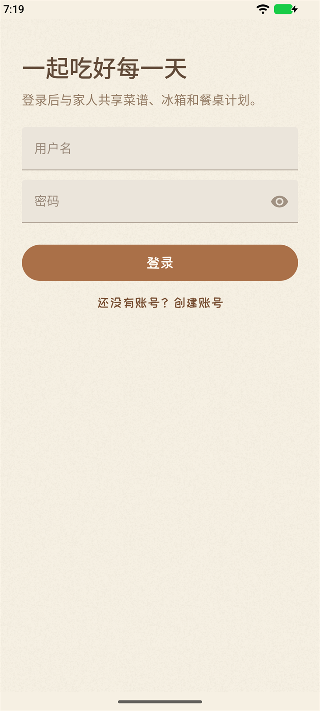
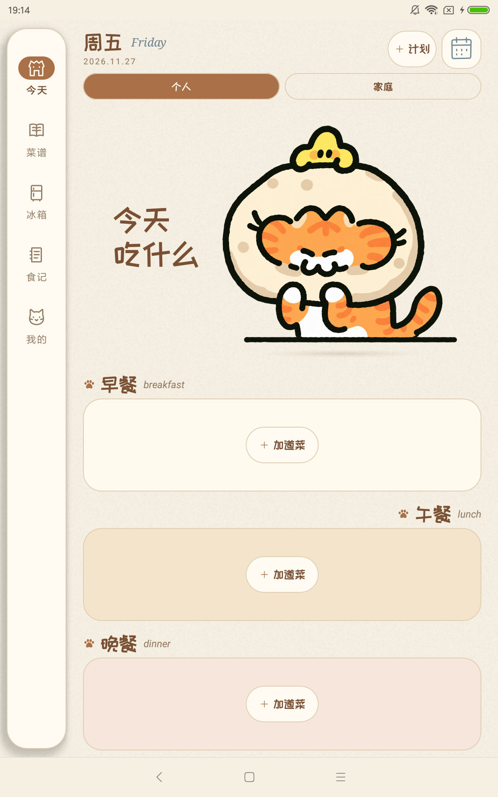
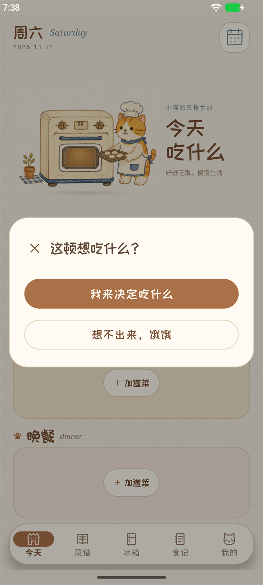
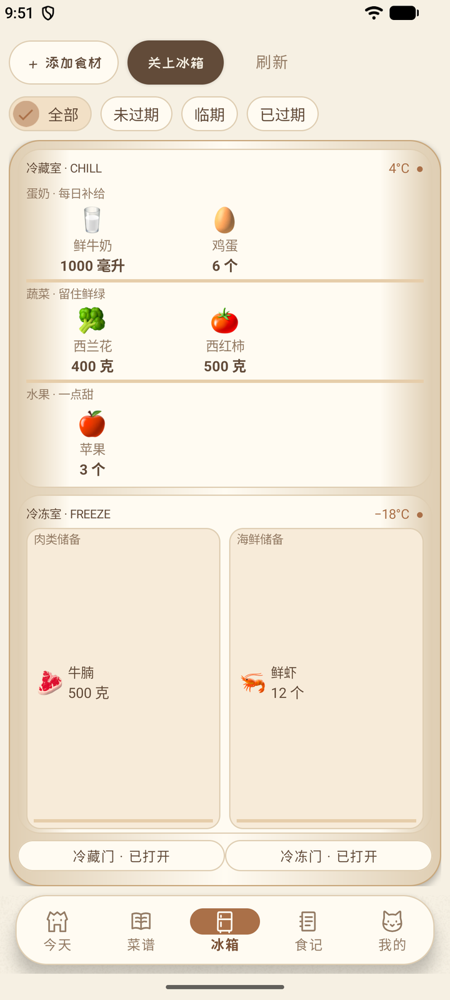
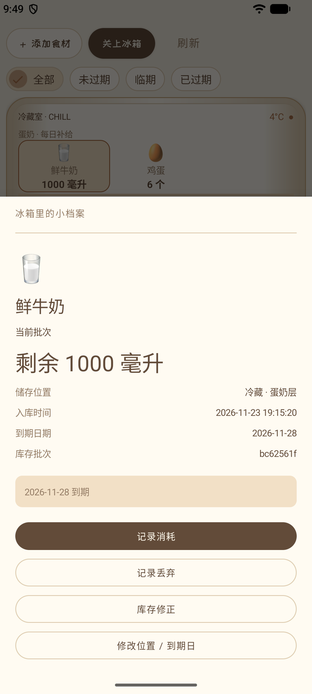
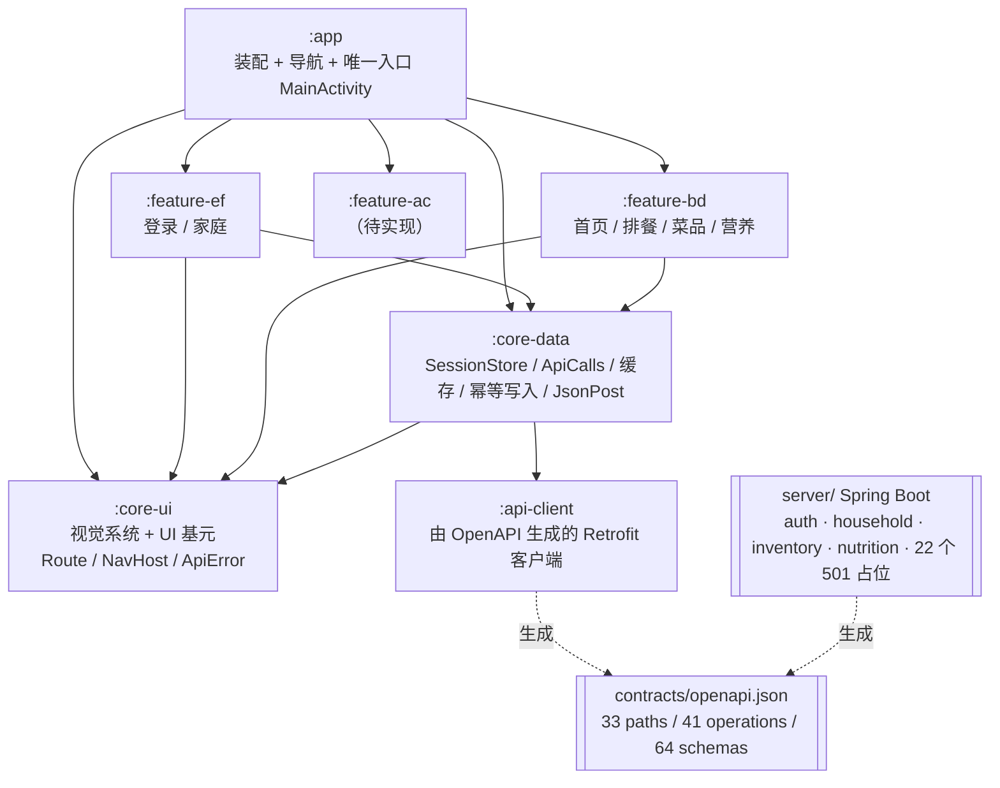

# Civa — 家庭菜谱、排餐与做饭记录

CSI301 小组项目：Android（Java + Views，7 个模块）与 Spring Boot 3 后端，
以 `contracts/openapi.json` 为唯一契约来源，客户端与服务端均由它生成。

| 登录 | 首页（今天） | 加道菜 |
| --- | --- | --- |
|  |  |  |
|  |  | |

截图来自真实运行的 debug 包（Android 模拟器）。

## 现在能做什么

| 功能 | 状态 |
| --- | --- |
| 注册 / 登录 / 登出（真实后端，Bearer + 会话代数隔离） | ✅ |
| 创建家庭 | ✅ 幂等键 + 待确认写入 |
| 加入家庭（邀请码） | ✅ 需服务端预置邀请记录（`createInvitation` 仍是 501） |
| 首页「今天」：日期/星期、日历换日、三餐列表 | ✅ 本地草稿，不写服务端 |
| 加菜流程：手动录入 / 偏好筛选 / 抽签推荐 | ✅ |
| 菜品详情：菜谱、编辑做法、移除、用餐选择 | ✅ |
| 营养估算（服务端代理：缓存 + 限流 + 供应商抽象） | ✅ 可失败降级 |
| 冰箱（库存）：批次录入、消耗/丢弃/修正、临期筛选、英文食材名 | ✅ 服务端 8 个操作 + 原生冰箱页 |
| 菜谱 / 食记 / 我的 | ⏳ 占位页（AC / EF 组范围） |

首页草稿是**个人本地数据**：按账号 + 家庭做 SHA-256 作用域隔离，不产生做饭记录、
不扣库存、不写共享排餐。详见 [`docs/DATA_CONTRACT.md`](docs/DATA_CONTRACT.md)。

## 架构



规则（由测试强制执行）：

- feature 只依赖 `core-ui` / `core-data` / `api-client`，不依赖 `app`、不互相依赖；
- feature 不直接开网络连接，HTTP 走 `ApiCalls`（`core.data.JsonPost` 用于非契约通道）；
- 共享主题与组件只属于 `core-ui`，feature 不得重定义 `civa_*` 主题 token；
- 公开类型必须登记在 `contracts/public-surface.draft.json`，或显式标注为内部。

## 快速开始

前置：JDK 17、Android SDK（platform 36）、Docker Desktop。Python 3.11 仅在跑契约工具时需要。

```powershell
git clone https://github.com/XJTLU-CSI301-Group27/civa-arch.git
cd civa-arch
Copy-Item .env.example .env      # 填 POSTGRES_PASSWORD 与 DB_PASSWORD（两处保持一致）
```

然后用 Android Studio 打开工程，直接 **Run app** 即可。

debug 构建会自动准备本地环境（`devStackEnsure`）：

1. 检查 5432，必要时 `docker compose` 启动 PostgreSQL 容器；
2. 后端 jar 缺失或比源码旧时用 `server/build` 的 wrapper 重新构建；
3. 以 detached 进程启动后端（日志 `server/build/logs/dev-stack.log`），等待 8080。

它不会让构建失败：Docker 不可用时打印 `[dev-stack] ...` 警告，App 仍可安装。
`CI` 环境或 `-PdevStackOff` 会跳过。模拟器访问后端用 `10.0.2.2:8080`（debug 默认）。

命令行等价入口（`local` 任务组，详见 [`docs/LOCAL_DEV_STACK.md`](docs/LOCAL_DEV_STACK.md)）：

```powershell
.\gradlew.bat devDoctor        # 一次性打印 Docker/端口/配置诊断
.\gradlew.bat dbUp             # 只起数据库
.\gradlew.bat serverRun        # 只起后端（阻塞，Run 窗口停止）
.\gradlew.bat :app:assembleDebug
```

> 单入口：`MainActivity` 是唯一 launcher。首页在**登录并加入家庭后**出现在「今天」，
> 冰箱 tab 已接入（需要后端 + 登录 + 家庭）；其余三个 tab 仍是占位页。测试账号：`verify_1209` / `Passw0rd2026`。

## 契约与门禁

| 门禁 | 作用 |
| --- | --- |
| `validateContract` / `generateClient` / `generateServerApi` / `checkContracts` | OpenAPI 结构、客户端与服务端生成一致性 |
| `scripts/contract_guard.py` | 契约变更必须有 IC 记录授权 |
| `FeatureDependencyArchTest` | feature 包不得出现 `okhttp3` / `java.net`；并断言被测包非空 |
| `ModuleBoundaryArchTest` | feature↛app、feature↛feature、core-ui↛core-data、core-data↛feature |
| `ResourceOwnershipTest` | feature 不得引用 `app_*`、不得重定义 `civa_*`/`Civa*`、app 不得直用 feature 资源 |
| `PublicSurfaceArchTest` + `PublicSurfaceCompletenessTest` | 已登记符号存在；新 public 类型必须登记或声明内部 |
| `AppWiringTest` | `Route.TODAY`/`Route.INVENTORY` 必须接到真实 Fragment（防止退化成占位页） |
| `lint { error 'ResourceName' }`（各模块） | `app_` / `civa_` / `bd_` / `ef_` 前缀 |

CI：`.github/workflows/ci.yml`，三个作业（契约 / Android / 服务端集成）+ `CI gate`。
本地一次性校验：

```powershell
.\gradlew.bat assembleDebug testDebugUnitTest lint
cd server; .\gradlew.bat test bootJar    # 需要以 _test 结尾的 PostgreSQL
```

## 目录结构

```
app/           装配：CivaApplication、AppContainer、MainActivity、AppNavigator
api-client/    OpenAPI 生成的 Retrofit 客户端（唯一网络契约产物）
core-ui/       视觉系统（civa_* 色板、KuaiLe 字体、Civa* 样式）+ UI 基元 + Route/NavHost
core-data/     SessionStore、ApiCalls（缓存/401/吊销）、PendingWriteStore、ApiProvider、JsonPost
feature-ef/    登录、家庭（LoginHost / HouseholdHost）
feature-bd/    首页、加菜、菜谱、营养（312 道菜谱与 149 张图随模块打包）
feature-ac/    冰箱库存页（inventory：批次/消耗/临期筛选），UI 用 civa_* 设计令牌
server/        Spring Boot：auth、household、inventory、nutrition、application、config、web(501)
contracts/     OpenAPI、生成器配置、fixtures、IC 记录、公共面清单
docs/          规格、ADR 001–004、本地栈、验证记录、截图
scripts/       契约门禁与 preflight
```

## 文档

- [架构基线](ARCHITECTURE_BASELINE.md)｜[本地栈与排错](docs/LOCAL_DEV_STACK.md)
- [数据契约](docs/DATA_CONTRACT.md)｜[UI 规则](docs/UI_RULES.md)｜[测试计划](docs/TEST_PLAN.md)
- ADR：[001 基线](docs/decisions/ADR-001-baseline.md)、[002 幂等摘要](docs/decisions/ADR-002-idempotency-digest.md)、
  [003 共享视觉系统](docs/decisions/ADR-003-shared-visual-system.md)、
  [004 BD 模块化](docs/decisions/ADR-004-bd-module-migration.md)、
  [005 营养服务端代理](docs/decisions/ADR-005-nutrition-proxy.md)

## 已知限制

- **模拟器黑屏**：API 37.x 预览镜像在 host GPU 下合成器会崩（`android.hardwar` SIGABRT），
  表现为首个 Activity 黑屏、"回桌面再进才显示"。把 AVD 的 Graphics 设为
  `Software - GLES 2.0` 并 **Cold Boot Now** 即可；详见本地栈文档。
- 营养估算由服务端代理（`POST /api/v1/nutrition/estimates`）：供应商 key 只存在服务器
  `CIVA_NUTRITION_API_KEY`；未配置 key 时服务端用确定性 stub，配置了才真正调用模型。
- 41 个契约操作中 8 个已实现，33 个返回 `CONTRACT_NOT_IMPLEMENTED`（501）。
- 组员成果以压缩包交接，由本地按模块整合，不直接合并对方分支。

## 团队分工

| 组 | 范围 |
| --- | --- |
| AC | 菜谱、食材、库存、收藏、做饭历史 |
| BD | 排餐、推荐、做饭确认、用餐记录 |
| EF | Android 基础、账号、家庭、共享 UI 与集成 |
