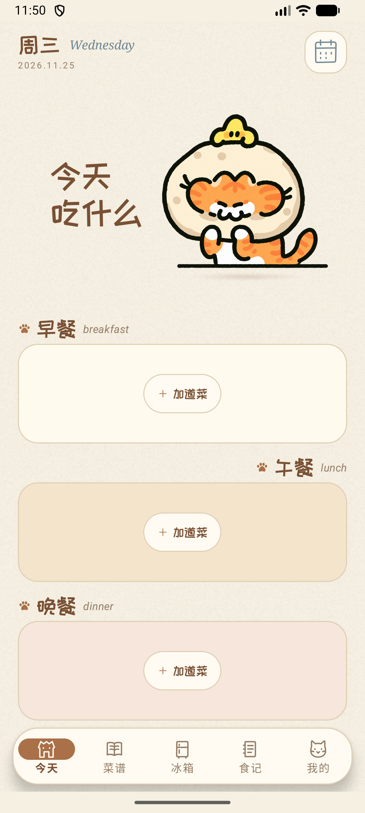
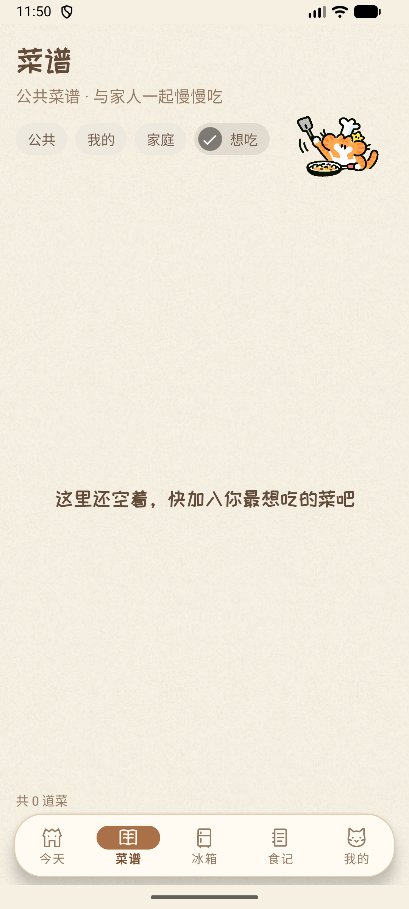
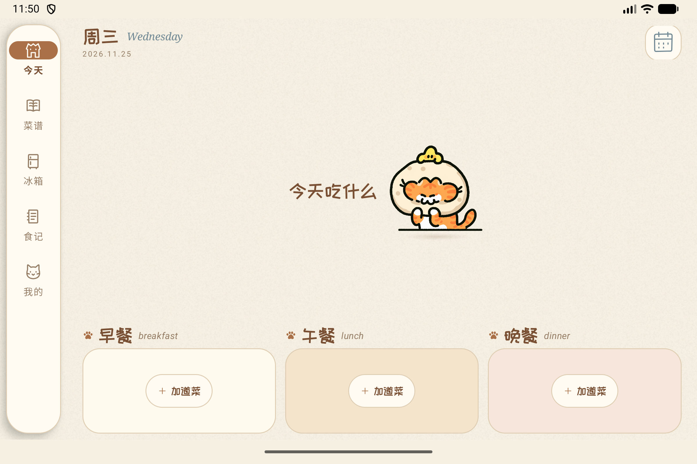

# EF / AC / BD 空态、家庭返回与邀请码交接（2026-11-25）

> 本文的家主限制 / 一次性邀请规则已被用户后续需求覆盖；当前实现与迁移见 [EF_SHARED_FAMILY_HANDOFF.md](EF_SHARED_FAMILY_HANDOFF.md)。以下保留历史结果，不作为现行规则。

实际工程：`C:\Users\18192\Desktop\civa-arch-main\civa-arch-main`。
沿用可爱、温暖、烘焙小猫的 UI。当前目录为下载包，没有 Git 历史；本轮只修改本地指定工程，未推送 GitHub、未同步或验证最新 main。

## 用户需求与最终页面

1. 去掉菜谱空态中间重复的“＋ 添加菜谱”；保留标题右侧“＋ 新建菜谱”（仅我的 / 家庭显示）。
2. 想吃列表加载完成且为空时显示“这里还空着，快加入你最想吃的菜吧”。保留插画下方空间、分页及来源请求代次保护。
3. 今天标题向右侧小猫靠近：普通布局容器 translationX 36dp，宽屏 28dp；自动字号上限普通 38sp、紧凑 25sp。小猫和三餐容器边界不变。
4. 家庭页面记录入口来源到 Fragment arguments，旋转 / 尺寸重建继续保持来源。

| 进入方式 | 创建成功 | 加入成功 | X / 系统返回 | 普通成员退出成功 |
| --- | --- | --- | --- | --- |
| 登录后首次家庭设置 | 今天 | 今天 | 今天 | 不适用（首次尚无家庭） |
| 我的 → 家庭设置 / 加入家庭 | 我的 | 我的 | 我的 | 我的 |

保留首次家庭页替换登录页的处理，防止返回旧登录页后再次被重定向。家主不能退出的限制按用户先前确认保留，不增加转让或解散。

## 加入失败的原因与使用方式

用户确认填入的是“当前家庭”下的 UUID **家庭 ID**，而加入接口要求26位字母数字 **邀请码**。诊断时正常开发库没有可用邀请记录；此前 createInvitation 仍为501，页面也没有生成入口。家庭 ID 是标识，不作为加入凭证。

现在输入家庭 ID 会明确提示“这是家庭ID，请向家主要26位邀请码。”，字段旁也有说明。提交时收起键盘，错误自动滚入可见范围。

邀请码生成候选的状态：**用户已确认采用；小组整合时仍需按团队流程审阅。**

使用路径：家主登录 → 我的 → 家庭设置 → 生成家庭邀请码 → 复制邀请码 → 分享给对方 → 对方在加入家庭字段粘贴。
生成按钮由当前成员角色控制；后端也检查 OWNER 权限，不能依赖前端隐藏来授权。邀请24小时有效、只能使用一次；过期 / 用过后由家主重新生成。
测试实际从页面生成与复制，再以同幂等键读取原结果（仅为恢复中断的测试流程），另一真实测试账号通过页面加入；没有 SQL 预置邀请码。

## 接口、持久化与维护边界

- 复用现有 `POST /api/v1/households/{householdId}/invitations`、Invitation DTO、Idempotency-Key、ApiCalls 与 PendingWriteStore。未修改 OpenAPI、生成代码、公开方法签名、数据库结构或迁移；没有新增依赖。
- 按 PROJECT_DOC 既有规范生成128位随机 Base32 邀请（26字符、24小时），invitations 表只存哈希。创建与重放均检查当前家主身份；非成员 / 普通成员拒绝，使用既有事务与行锁。
- 为解决 OPEN_QUESTIONS.md 中“哈希存储但原成功响应需重放”的冲突，候选采用 AES-256-GCM 加密幂等回执中的 code 字段。数据库不存明文邀请码；重放在授权后解密，保持公开成功响应不变。
- 密钥在服务端 `CIVA_MEDIA_DIR/.private/invitation-receipt.key`，32字节，首次创建、以后复用；不可提交、分享或与数据库日志一起公开。真实开发启动器已设置持久化的 `.civa-local/media`。备份 / 多实例部署必须保留并安全共享同一密钥；损坏文件不覆盖、无法解密失败关闭。
- `CIVA_MEDIA_DIR` 未设置时回退 `./build/private-media` 仅用于本地 / 测试。清理这个目录会失去既有回执的解密能力；部署务必配置持久化私有目录。幂等记录保留仍由既有幂等清理策略负责，本轮未增加独立定时删除。
- `.gitignore` 增加 `**/invitation-receipt.key`。不能通过公开媒体路径提供 `.private` 文件；该路径为私有后端目录。
- Android 创建邀请的待确认记录仅保存请求键 / 家庭作用域，不保存返回的明文邀请码；邀请码对话框只使用当前 ViewModel 内存，关闭 / 生命周期正确清理，复制使用敏感剪贴板标记。
- 新服务 / cipher / 测试为 household 包私有类；新 Android 资源 id 为对话框定位使用。AppNavigator 仅增加内部入口参数，保留旧 host 接口供现有模块调用。

## 验证与运行状态

- Android：`gradlew.bat :app:assembleDebug testDebugUnitTest lint --console=plain` 成功；124项单测，0失败 / 错误 / 跳过；lint 0错误、83警告（原工程已有警告仍保留）。
- 服务端：在 native PostgreSQL 55433 的独立 `civa_family_test` 库运行 `gradlew.bat -I .civa-local/server-maven.init.gradle test --tests '*InvitationReceiptCipherTest' --tests '*HouseholdLeaveIntegrationTest' --tests '*HouseholdHttpIntegrationTest' --tests '*HouseholdReadIntegrationTest' bootJar --console=plain`，6个测试方法全部通过。
- 覆盖：真实创建邀请、同键同码且仅一条记录、无明文回执、普通成员拒绝生成、已用 / 过期邀请拒绝、真实加入、退出 / 撤权；3个 cipher 测试覆盖重启复用、篡改 / 错钥失败、损坏密钥不被替换。
- `python scripts/check_contracts.py` 一致；`python -m unittest discover -s scripts -p 'test_contract*.py'` 16项通过。
- 已运行 UI 自动检查：首次跳过 / 创建 / 加入到今天；我的来源关闭 / 创建 / 加入 / 退出到我的；入口来源经过窗口尺寸重建仍保留；家庭 ID 提示；我的空态无重复按钮；想吃空态；手机1080×2400及宽屏2400×1600人工查看截图，标题完整、猫不遮挡、三餐可见。
- 自动 UI 初轮受拼音输入法候选栏和键盘遮挡影响中断；使用数字测试家庭名、检测实际键盘状态，并修复提交收键盘及错误滚动后重跑。以 `ui-final.log` / `flow-result.json` 为最终结果，未把中断轮次当通过。
- 已更新正常8080本地后端、保留55433数据库；最终正式包 `edu.xjtlu.civa` 使用8080地址覆盖安装，6个原有本地草稿 / 照片 / 个人资料文件逐一哈希不变。新开场视频实际播放到完成，无 fallback。
- 独立测试应用已卸载、本轮8081测试后端已关闭；测试库保留，原来运行的模拟器和正常后端保留。未清除正式应用数据，未把开发库当测试库。
- 未运行物理真机、并发多实例或最新 main 整合验证；不代表这些范围已验收。正式组内整合前仍需审阅 OPEN_QUESTIONS 的加密回执决策及部署密钥管理。

[检查汇总](verification/empty-invitation/check-results.json) · [页面流程结果](verification/empty-invitation/flow-result.json) · [安装与资料保留](verification/empty-invitation/production-install.json) · [完整源码差异](verification/empty-invitation/source-changes.diff) · [源码前后哈希](verification/empty-invitation/source-audit.json)

## 本轮源码 / 资源变更（20个文件）

| 文件 | 最终 SHA-256 |
| --- | --- |
| `feature-ac/src/main/res/layout/ac_fragment_catalog.xml` | `24de587e2ea6e793faeb243d45305c996a61f4697de8a7fa17d5f2ae66251516` |
| `feature-ac/src/main/java/edu/xjtlu/civa/feature/ac/catalog/RecipeCatalogFragment.java` | `7726be780b78be4b74ea92e0cb6ab54361a9209dff5038832da4f61ff8371845` |
| `feature-ac/src/main/res/values/ac_strings.xml` | `e73934afbad4e041c10866e71bffe8e70fdbea224285515fb7e832f82f926c62` |
| `feature-bd/src/main/res/layout/bd_fragment_home.xml` | `19227fd3e387c4a1aeff6cafc063727acc320eca11eb51f02ec856be8f15916f` |
| `feature-bd/src/main/res/layout-w600dp/bd_fragment_home.xml` | `12d472f9d3870b9bbd12b100e87a7bc827bbe9cf657c7743bc18bde78c5ec386` |
| `feature-bd/src/main/java/edu/xjtlu/civa/feature/bd/BdHomeLayout.java` | `2922315ceffa73dfddece60de80f02d7aad7c43e5f9f69bc272e7c3fd4118f1c` |
| `app/src/main/java/edu/xjtlu/civa/AppNavigator.java` | `154a62896f0e460fe2d9bc0344b2907ccb9dcf9b4ffc6a5dffa648106bf3c4cd` |
| `feature-ef/src/main/java/edu/xjtlu/civa/feature/ef/HouseholdFragment.java` | `887fac6659c4f189644a623b4559ec7b88b93ae54b22f8e8f6743a69ae79bec5` |
| `server/src/main/java/edu/xjtlu/civa/server/household/HouseholdController.java` | `99446434408ccfd47df52772ec3f4163135ce10ad78d321362a7f4a6d2824557` |
| `server/src/main/java/edu/xjtlu/civa/server/household/HouseholdConfiguration.java` | `d1cc2bcafbd31638d07441108e02be7b6f619257c15d3eba22a4fb1d43754b70` |
| `feature-ef/src/main/res/layout/ef_fragment_household.xml` | `cec399fe7f8875cf57e078734ee99c3b70b9ad816774428acff1229d682048d0` |
| `feature-ef/src/main/res/values/ef_strings.xml` | `b5df821260d77d47177511c2717ce3e8716501754353b1ed14746744532681b2` |
| `feature-ef/src/main/java/edu/xjtlu/civa/feature/ef/HouseholdViewModel.java` | `69181be66b443f7e45b2b3e4adbbf166ce2b8e0ff1bf68dea0eb5c27cfd49dae` |
| `server/src/main/java/edu/xjtlu/civa/server/household/InvitationReceiptCipher.java` | `b925a0d5f89ff84c3845b57d593a197ebb027c7eb7a6d604beb5c06570f44f30` |
| `server/src/main/java/edu/xjtlu/civa/server/household/HouseholdInvitationService.java` | `b0391e88de37edccf1bc30b3368a93d882ef4ac0ed22173fa7f8e7a04e7d9ff1` |
| `feature-ef/src/main/res/values/ef_ids.xml` | `345de1d16190e40e8458ee345ce8685798ba20cdb44b0a934863df9bfd32f074` |
| `server/src/test/java/edu/xjtlu/civa/server/household/HouseholdHttpIntegrationTest.java` | `a1d0436a4b51aeb6e4ca7161336b01ea1ae6ebc794c99d5f78a3324a57b9e88e` |
| `server/src/test/java/edu/xjtlu/civa/server/household/InvitationReceiptCipherTest.java` | `6361a3be51955afff13850ac9961754f8c3631da69e9b827709c5ec767afbef7` |
| `.gitignore` | `c0b0c474b040196e3ca373768cd9f9e50f7ec94560672ab92d86892fc92967f4` |
| `server/src/main/resources/application.yml` | `d7fe2b8aa10b05a4255bfc93697a0ba564ae888ef859d8b940f77b0a47857644` |

共享文档同步更新：README、OPEN_QUESTIONS、DATA_CONTRACT、UI_RULES、TEST_PLAN、HANDOFF；旧 EF_FAMILY_CATALOG_HANDOFF 顶部标记当前规则已由本轮覆盖。验证仅复制选定日志 / 截图，不包含邀请码弹窗、凭据、密钥、数据库或本地测试账号文件。
