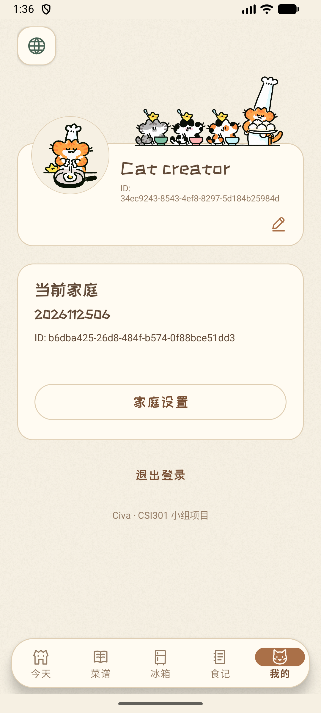
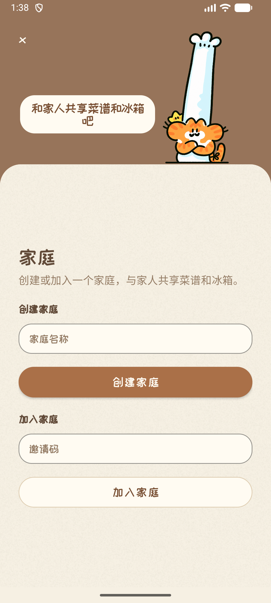

# EF 家庭名编辑与设置上移交接（2026-11-25）

实际工程：`C:\Users\18192\Desktop\civa-arch-main\civa-arch-main`。继续使用统一的可爱、温暖、烘焙小猫风格。
用户要求：已加入家庭的设置内容整体上移，标题不再显示家庭名，改为“修改家庭名”，下面编辑名称、可复制邀请码、保存、退出家庭。
本轮只修改和验证本地工程；下载包无 Git 历史，没有推送 GitHub、拉取最新 main 或声称团队正式接受新接口。接口登记见 [IC-20261125-EF-FAMILY-NAME](../contracts/changes/IC-20261125-EF-FAMILY-NAME.md)。

## 最终页面与行为

- 仅已加入家庭：表单容器改为 TOP 对齐，上下30dp内边距，去掉原来垂直居中带来的大片空位。普通1080×2400页面标题top=733px，全部控件在首屏；宽屏 / 小高度窗口仍能滚动，底部内容不被永久遮挡。
- 从上到下为 **修改家庭名 → 家庭名称输入框（预填当前名，可编辑）→ 邀请码 / 固定码 → 复制邀请码 → 保存 → 退出家庭**。标题不再用实际家庭名称替换。
- 保存成功留在设置中，显示“家庭名已保存”；关闭回到我的后通过真实getHousehold显示新名字。创建者和普通加入成员都能修改，所有成员后续读取共享同一个名字。
- 名字trim，不能为空，最多120 Unicode字符。没有XML maxLength截断已有长Unicode名字；使用既有字体、输入框和主按钮，不新增主题或依赖。
- 关闭未保存编辑不写服务端；窗口重建期间的未保存输入留在当前ViewModel，不让加载回调覆盖草稿。请求中禁用保存 / 输入 / 退出 / 关闭，避免重复或不确定操作。
- 邀请码、复制、固定码长期有效、成员平等与最后退出注销等上一轮规则不变。未加入时仍是原来的创建 / 加入界面；登录页面布局不变。

## 新增接口与并发语义

原契约没有改家庭名接口，因此添加 `PUT /api/v1/households/{householdId}`，operationId **renameHousehold**。
必需query `expectedVersion`（int64，>=0），JSON body复用既有 CreateHouseholdRequest `{"name":"新家庭名"}`，200返回既有 Household；没有新DTO、数据库字段、迁移或运行依赖。
输入非法400，未登录401，非成员404 / 已退出成员403，已注销家庭404，版本不符409 VERSION_CONFLICT，按既有错误体规范处理。家庭名不要求全库唯一；家庭ID才是身份。

服务端包私有 HouseholdSettingsService 在事务中先锁未注销household行，再检查当前活动成员与版本；与加入 / 退出锁顺序一致。更新name、version+1、updated_at，其他字段不变；相同名字且版本一致为无操作成功，不无故递增版本。任何成员都不能用旧版本静默覆盖他人编辑。

客户端只经 ApiCalls / 生成的HouseholdApi提交。版本冲突后GET最新版本，保留草稿，提示“其他成员修改了家庭信息。你输入的名字已保留，请确认后再保存。”；用户再次点击才提交。网络结果未知时GET对账，若服务端已是期望名字则显示成功，否则保留输入和错误，不盲目追加新写入。PUT使用expectedVersion防止重复写入，不新增离线自动重放队列。
公开契约只增加operation，复用DTO；生成客户端 / 服务端均来自 contracts/openapi.json，没有手工改 generated 文件。手写host接口和已有公共方法签名不变。

## 实际验证

- Android：`gradlew.bat :app:assembleDebug testDebugUnitTest lint --console=plain` 成功，124项单测0失败 / 错误 / 跳过；lint0错误、83个既有警告。正式包最后使用8080，独立测试包使用8081。
- 服务端：在独立 PostgreSQL `civa_family_test` 执行 `server/gradlew.bat -I .civa-local/server-maven.init.gradle test bootJar --console=plain`，完整61项测试0失败 / 错误 / 跳过。
- 新 HouseholdNameIntegrationTest 两个方法覆盖：普通成员改中文名、trim、空白 / 过长拒绝、无权限 / 撤权拒绝、stale版本409、同名不增版本、邀请不变；两个成员同时以同一版本改名，恰好一个200 / 一个409，没有覆盖丢失。
- `python scripts/check_contracts.py` 一致；`python -m unittest discover -s scripts -p 'test_contract*.py'` 16项通过。
- 真实UI操作：上移和控件顺序 / 初始可编辑名字；空白不能保存；保存后停留并提示；我的及另一成员读到新名字；邀请码与复制功能保留；取消不保存；2400×1600窗口重建后草稿保留、随后恢复1080×2400；另一成员先更新导致冲突时草稿保留，明确重试后成功；普通加入成员也能从页面改名；未加入时原表单正常。
- 几何证据只记录控件ID与bounds：[layout-metrics](verification/family-name/layout-metrics.json)。没有保存 / 发布包含有效邀请码的设置截图或界面树；只分享不含邀请码的我的、未加入页面。

## 环境、资料与边界

正常后端8080已更新；本轮无需数据迁移。更新前完成正常库pg_dump与私有密钥的本地备份，备份未放入项目文档。更新后检查16张业务表行数及内容摘要全部一致，邀请私有密钥不变；测试只使用独立库和随机测试账号，没有改用户正常家庭名来冒充测试。
正式 `edu.xjtlu.civa` 已覆盖安装，10个原有本地草稿 / 图片 / 个人资料文件逐一哈希不变；原开场视频真实播放完成，无fallback。
独立QA应用卸载、本次8081服务关闭；正常8080后端、55433数据库和此前运行的模拟器保留。测试库保留，没有清除正式应用数据。
未验证物理真机、断网丢响应的真实故障注入或最新main整合；GET对账分支已实现，但不把未注入的故障说成设备测试通过。团队整合时需一并带新增PUT接口和两端生成结果 / 构建输入。

[检查汇总](verification/family-name/check-results.json) · [实际UI流程](verification/family-name/flow-result.json) · [正常库保留](verification/family-name/development-update.json) · [正式安装与资料](verification/family-name/production-install.json) · [源码差异](verification/family-name/source-changes.diff) · [源码前后哈希](verification/family-name/source-audit.json)

## 源码 / 契约 / 测试变更（10个文件）

| 文件 | 最终SHA-256 |
| --- | --- |
| `contracts/openapi.json` | `8f7ac10487692e0da1d7e739a7d8643f4d0e69282944cf66385118296ddf8abb` |
| `server/src/main/java/edu/xjtlu/civa/server/household/HouseholdSettingsService.java` | `774141b4fa54328626823270ec9ba8a105c91b46fbec03cb23a05dd0fe51b0aa` |
| `server/src/main/java/edu/xjtlu/civa/server/household/HouseholdConfiguration.java` | `7ba73e5fbebc5638c92466d31f7333acc3ca8bdd346ea8a384731383b13339e7` |
| `server/src/main/java/edu/xjtlu/civa/server/household/HouseholdController.java` | `fc2289a9c7c6dfd5c6752547140da86ae7d1291d94a25bf5766fed12eaa8f034` |
| `feature-ef/src/main/res/layout/ef_fragment_household.xml` | `3296444980c4dd7ce75bac26cb53472a69e9f866452d50c6a9f1e69ebdeb6366` |
| `feature-ef/src/main/java/edu/xjtlu/civa/feature/ef/HouseholdViewModel.java` | `bb966e35456ab6f69367a1de573529cf3a77230c326b95179126c4d876906a3b` |
| `feature-ef/src/main/java/edu/xjtlu/civa/feature/ef/HouseholdFragment.java` | `73532952a670f16d9e441d0d5f28bc3b468a45db13df9c95310c1beb329830e3` |
| `feature-ef/src/main/res/values/ef_strings.xml` | `ed0ef635f8c919d00ed2df155b742996092f46c04a11b3131d3664f6d9dd18d8` |
| `contracts/changes/IC-20261125-EF-FAMILY-NAME.md` | `892c4ac93240af44a8768b086a0e83587f55f9f015b0c88b77109ee8238e9ba4` |
| `server/src/test/java/edu/xjtlu/civa/server/household/HouseholdNameIntegrationTest.java` | `d2458eb97cf50b9d0738b8e5ef6058cfeb289c10ad6cc5f32036fd285f7e2159` |

共享文档同步更新：DATA_CONTRACT、UI_RULES、TEST_PLAN、HANDOFF、PROJECT_DOC、README和上一轮家庭交接的现行规则说明。文档本身的修改记录见 [文档审计](verification/family-name/documentation-audit.json)。
