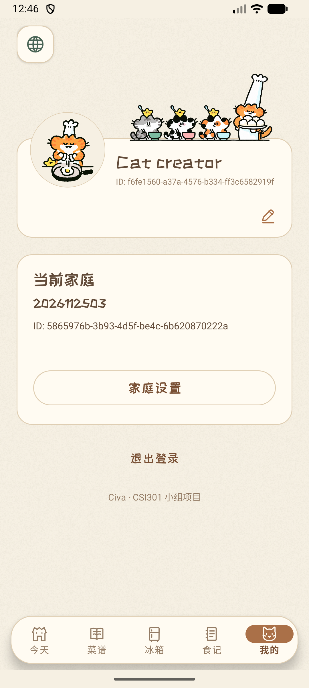
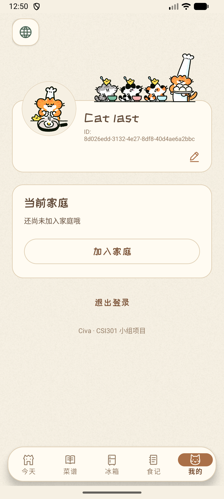
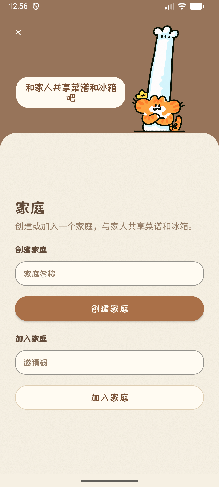

# EF 家庭成员平等、固定邀请码与设置分流交接（2026-11-25）

> 后续家庭设置已上移并增加修改家庭名 / 保存；最新页面、PUT契约及验证见 [EF_FAMILY_NAME_HANDOFF.md](EF_FAMILY_NAME_HANDOFF.md)。本文的平等成员、固定邀请码与注销规则继续有效。

工程：`C:\Users\18192\Desktop\civa-arch-main\civa-arch-main`。继续使用可爱、温暖、烘焙小猫的统一风格。
用户本轮明确取消之前的“家主不能退出”决定，授权全员平等、固定永久邀请码、最后一人退出注销家庭。本轮已在本地实现和真实验证；不是 GitHub 推送、main 整合或团队正式契约冻结。
接口变更登记：[IC-20261125-EF-PERMANENT-FAMILY](../contracts/changes/IC-20261125-EF-PERMANENT-FAMILY.md)。候选当前本地已验证；跨组整合仍按团队流程审阅，不伪造 EF 接受 / Git SHA / Issue。

## 页面与使用方式

- 我的 → 当前家庭：显示真实家庭名称、家庭 ID、家庭设置。名称读取既有 getHousehold，不把 UUID 当名称，不修改用户名或个人资料。
- 已加入家庭 → 家庭设置：家庭名称标题、**邀请码**标签、同一固定邀请码（可选中文本）、复制邀请码、退出家庭；隐藏创建 / 加入输入框、生成新码按钮和旧恢复控件。
- 未加入 / 退出成功：我的恢复“还尚未加入家庭哦 / 加入家庭”；再进入显示创建家庭名称输入与按钮，以及邀请码输入与加入按钮。
- 去掉邀请码输入下方“填写家主生成的26位邀请码，不是家庭ID”的说明；不再出现家主限制或一次性 / 24小时提示。
- 全员包括创建者都能退出，只能退出自己，不能移除他人。退出前确认会说明最后一位成员退出将注销；个人资料 / 个人菜谱保留。
- 保留上轮返回规则：首次登录家庭设置的创建 / 加入 / X / 系统返回 → 今天；我的来源创建 / 加入 / X / 系统返回 / 退出 → 我的，入口参数随页面重建保留。
- 已明确失败的家庭写请求会清除待确认记录，避免下次恢复成“未确认操作”。网络结果未知仍保留同键重试；没有悄悄去掉防重复保护。已加入时清理已对账的旧设置记录、旧生成邀请记录。

## 固定邀请码与成员权限

1. 创建家庭的事务同时创建 MEMBER membership 和唯一永久邀请码。任何活动成员读取 / 复制的是同一条记录，同一字符码；不随时间、使用次数、读取、不同成员或后端重启变化。
2. 保持128位 SecureRandom Base32大写无填充（26字符），全库 code_hash 唯一，家庭永久邀请只有一条。输入保留既有去空白 / 大写 / 规范编码校验，用户一次仍最多属于一个活动家庭。
3. 邀请不再消费或按时间过期；最后一人退出时家庭 closed_at 被置位。加入与退出先锁同一 household 行，所以并发加入要么先成功并使家庭继续存在，要么在注销后被拒绝，不复活已关闭家庭。
4. 注销后的家庭 ID 不能重新激活，固定码返回 INVALID_INVITATION。家庭行、inactive membership 历史、菜谱 / 库存 / 食记外键保留以保护历史，不物理级联删除。用户新建同名家庭会获得新 ID、新码。
5. 所有活动角色为 MEMBER。OWNER 仅保留在旧枚举 / 历史记录中兼容旧数据，不授予邀请、踢人或退出方面的特权。没有转让家主入口。

## 跨组接口与迁移（必须一起带走）

| 项目 | 新行为 / 影响 |
| --- | --- |
| 新增 GET `/api/v1/households/{householdId}/invitations` | operationId getHouseholdInvitation，任意活动成员200读取固定邀请码；非成员404 / 已退出403；不使用本地 GET 缓存保存邀请码 |
| 既有 POST 同路径 | createInvitation 保留但标记 deprecated；Idempotency-Key 仍必需，201返回同一固定码，不生成第二个码，不轮换；读取旧成功回执也不恢复旧一次性码 |
| Invitation.expiresAt | 字段仍 required，但现在 nullable；永久码返回 JSON null。客户端与后端必须同步更新，不能用伪造的未来时间代替永久 |
| removeMember | DELETE路径 / expectedVersion 不变，但权限改为仅当前成员退出自己；创建者也一样；最后退出同时注销，版本冲突仍409；不再返回 OWNER_CANNOT_LEAVE |
| HouseholdWriteService构造依赖 | 增加 BiConsumer&lt;UUID,UUID&gt; provisionInvitation，由 server配置传入固定码服务，创建事务内调用。直接构造的幂等执行器测试使用明确的测试邀请码夹具回调 |
| OpenAPI | 修改唯一输入 contracts/openapi.json，由既有生成任务生成两端代码，没有手改 generated 目录；公开面草案同步登记构造签名 |

新迁移 `V20261125210000__equal_members_and_permanent_invitations.sql`：添加 households.closed_at，删除旧单家主索引，活动 OWNER→MEMBER（version+1），invitations添加 permanent / sealed_code、允许 expires_at NULL，并约束永久码无过期/消费且有密文、每家唯一。旧V1及已应用迁移未改写。

升级已有数据：历史空家庭标为注销；已有非空家庭在服务启动的加锁幂等补齐阶段生成一个固定码，后续启动不重置。**旧24小时 / 一次性邀请码停止授权加入**；现有家庭成员不受影响，在家庭设置复制新固定码即可。
新家庭自动在同一个创建事务内生成；缺码状态不会伪造成功。权限由服务端成员检查落实，不依赖页面隐藏。

## 密钥与持久化

继续复用已确认的独立密钥 AES-256-GCM 方案：查询索引用 code_hash，sealed_code 与幂等回执只存密文，HTTP授权后才解密。返回码不写 Android 资料或缓存，复制使用敏感剪贴板标记。
`CIVA_MEDIA_DIR/.private/invitation-receipt.key` 必须与数据库一起安全保留 / 部署；本机是 `.civa-local/media/.private/`，升级前后逐字节检查不变。多实例必须使用相同私有密钥。丢失密钥不能从哈希恢复原码；不得删除密钥后声称旧码仍可读取。目录未配置时 build/private-media 仅供开发测试，不作持久部署默认。
本轮没有引入第三方依赖。没有公开邀请码、凭据、密钥、数据库备份或测试账户文件；交接截图只选不含邀请码的页面。

## 已执行验证

- Android：`gradlew.bat :app:assembleDebug testDebugUnitTest lint --console=plain`；124项单测通过，0失败 / 错误 / 跳过；lint 0错误、83警告。另建独立 QA 包连接8081，正式包最后恢复8080。
- 服务端：独立 PostgreSQL `civa_family_test`，`server/gradlew.bat -I .civa-local/server-maven.init.gradle test bootJar --console=plain`；完整59项全部通过，包含新并发测试。不是只跑家庭子集。
- HTTP / DB覆盖：自动固定码、同键重放、无明文密文回执、成员读取 / 兼容POST同码、多人重复加入不消费、成员平等、拒绝移除他人、撤权后拒绝旧重放、创建者先退出家庭保留、最后退出注销、旧码拒绝。
- 新 HouseholdLifetimeIntegrationTest 两个真实并发方法：加入与最后退出竞争；最后两位成员同时退出。验证关闭家庭不能存在活动成员，旧码不能重新加入。
- 原幂等执行器并发单家庭唯一性检查保留，旧“消费一次”断言更新为可重复邀请；测试没有删掉以掩盖行为变化。Cipher的3个重启 / 篡改 / 损坏保护测试继续通过。
- `python scripts/check_contracts.py` 一致，`python -m unittest discover -s scripts -p 'test_contract*.py'` 16项通过；没有伪造主线或团队批准门禁。
- 模拟器真实操作：新账号创建 → 今天；我的显示家庭名 / ID；设置仅固定码 / 复制 / 退出；成员用同码加入、查看和复制；创建者退出后第三人仍可用原码加入；成员依次退出、最后注销；旧码加入失败后再进没有错误恢复控件；新建家庭得到不同 ID / 码；首次跳过→今天，我的来源操作→我的；2400×1600重建保留设置，后恢复1080×2400。
- 临时后端实际停止再启动，读取固定邀请码摘要一致，证实不随服务重启变化。
- 初次构建发现ProfileHost不含数据接口，改复用现有 HouseholdHost；旧测试仍期待家主禁止退出 / 一次性码，按新规则增加正向、拒绝与并发断言。自动UI初轮有输入法检测、空字符串输入工具错误，已修复工具并从验证断点继续；最终以 flow-result 和分段实际日志核对，未把中断当完整通过。

## 正常环境升级与资料保护

升级前已对正常 civa_arch_dev 做完整 pg_dump 自定义格式备份并用 pg_restore --list 验证可读，私有密钥另行本地备份；备份未复制入项目 / 交接目录。
正常迁移后6个家庭行、7个成员历史行保留；users、sessions、个人菜谱/收藏、菜谱、库存/流水、排餐、做饭事件、食记、媒体、偏好共13张无关表的行数与内容摘要一致；活动角色全为MEMBER，所有非空家庭已获唯一固定码，密钥不变。
正式应用 `edu.xjtlu.civa` 已覆盖安装，8个原有本地草稿 / 图片 / 个人资料文件逐一哈希相同；开场视频实际完成，无fallback。
正常8080后端、55433数据库和此前已运行的模拟器保持运行；独立QA应用卸载，8081测试服务关闭，测试库保留。未清除正式应用数据。
未运行物理真机、多服务器共享密钥部署或最新 Git main 整合；不宣称这些已通过。

[检查汇总](verification/shared-family/check-results.json) · [实际页面流程](verification/shared-family/flow-result.json) · [迁移保留检查](verification/shared-family/development-upgrade.json) · [重启固定码检查](verification/shared-family/restart-result.json) · [应用资料保留](verification/shared-family/production-install.json) · [源码差异](verification/shared-family/source-changes.diff) · [源码哈希](verification/shared-family/source-audit.json)

## 实现 / 契约 / 测试变更清单（20个文件）

| 文件 | 最终SHA-256 |
| --- | --- |
| `server/src/main/resources/db/migration/V20261125210000__equal_members_and_permanent_invitations.sql` | `054259f419aa8a7443e4df8626457836d003ce9ced388f22504f3a8606e5f483` |
| `server/src/main/java/edu/xjtlu/civa/server/household/HouseholdInvitationService.java` | `f6f0061037dbd89c598d0a70f39cf8f4f0d0277e1a11e191701d2adb6109e4ec` |
| `server/src/main/java/edu/xjtlu/civa/server/household/HouseholdConfiguration.java` | `675682ef4aa9fbf564f321f82f80fc8d5ac10b777edda96aea6de9e59a339fc6` |
| `server/src/main/java/edu/xjtlu/civa/server/household/HouseholdWriteService.java` | `0ded0f7389271651b661ef8d4cd0ec45fa1403ac906df5a870ee165e9b2365f1` |
| `server/src/main/java/edu/xjtlu/civa/server/household/HouseholdMembershipService.java` | `ddf1b47c80426ce1e56cd8f2fab29eace6afc074d2b1d94448d57ec3d8c01002` |
| `server/src/main/java/edu/xjtlu/civa/server/household/HouseholdReadService.java` | `03261f9c4cbf85ee815aac8c2e55bdb44a23134b6e507ba483816314a543d46e` |
| `server/src/main/java/edu/xjtlu/civa/server/household/HouseholdController.java` | `754604c5d4ea5903fcc0ae99337cf4c6254f6fdbdf58defcdd9b3abf3284a0f9` |
| `contracts/openapi.json` | `d21e0e22f62ba13fd7b6264e3ebed0427287d5ca923c6ba94777a60ca7048d6f` |
| `contracts/public-surface.draft.json` | `476d0ee28a82fa2e3a7f0eee5afcb508a6521983c1931294231c416b97acad58` |
| `feature-ef/src/main/java/edu/xjtlu/civa/feature/ef/HouseholdViewModel.java` | `297213a765836c3e0087d907a4df22a7b38ff86aa328fda944f8c10cc4bd2dc6` |
| `feature-ef/src/main/res/layout/ef_fragment_household.xml` | `d7a4fca27e0007a9087d343500501a2fdb4693e32520053ab65f0832c5c0083a` |
| `feature-ef/src/main/java/edu/xjtlu/civa/feature/ef/HouseholdFragment.java` | `b49e135005654f5494f9916c97acf9e40caf67ef515a9f472d4df61d899d16e0` |
| `feature-ef/src/main/res/layout/ef_fragment_profile.xml` | `282e0e0ef1aa143cb6889567694d2b22241f5a677725a1c71723871bfe3656ca` |
| `feature-ef/src/main/java/edu/xjtlu/civa/feature/ef/ProfileFragment.java` | `63c6b824424693f1c88925fc44c10c0367a05165fb89f252db923d9118f1333a` |
| `feature-ef/src/main/res/values/ef_strings.xml` | `0144e326ad139f9520f8811482c04dccb4e33223d1d09b875c1667dd2ab9e4e6` |
| `server/src/test/java/edu/xjtlu/civa/server/household/HouseholdHttpIntegrationTest.java` | `a3eb0a553f1957d0000f6b6126dd379d9d716053816b89d65edacad64644aca2` |
| `server/src/test/java/edu/xjtlu/civa/server/household/HouseholdLeaveIntegrationTest.java` | `1d15922fb9850bfe6bf0c97c892a9d679e4a2c6204775bdf430039443c31c5a8` |
| `server/src/test/java/edu/xjtlu/civa/server/testing/IdempotencyIntegrationTest.java` | `8d9765ffb6b52e1d0a78955311ab09ede6d179f4d5ec3fe0f2ef6f3d7545bc13` |
| `contracts/changes/IC-20261125-EF-PERMANENT-FAMILY.md` | `61df24d5b88922085926be209a3282a4f2bac480e560187dae4280292f5eb926` |
| `server/src/test/java/edu/xjtlu/civa/server/household/HouseholdLifetimeIntegrationTest.java` | `040d0bc3961c8aaf718907ed59a9fee196bfa5c57da03ff063a0848cb22fcfe8` |

共享文档同时更新：PROJECT_DOC、DATA_CONTRACT、PRODUCT_RULES、UI_RULES、TEST_PLAN、HANDOFF、LOCAL_DEV_STACK、README、OPEN_QUESTIONS；上轮交接顶部标记本轮覆盖其家主 / 一次性码规则。完整文档记录见 [文档审计](verification/shared-family/documentation-audit.json)。
