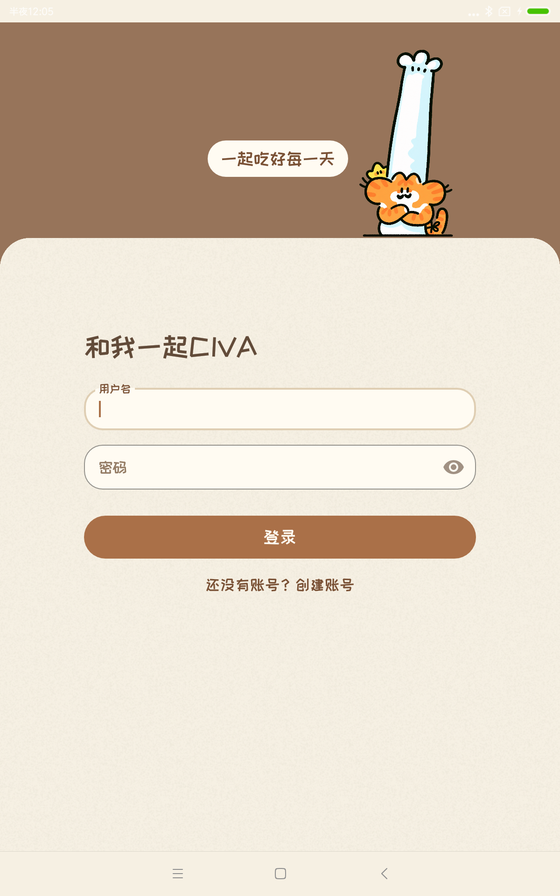
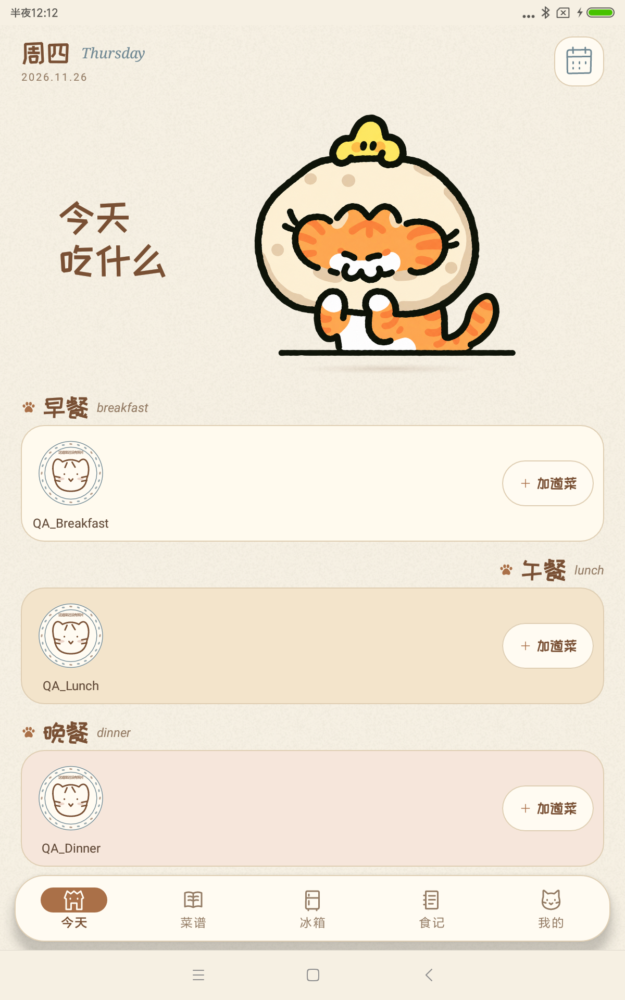

# 小米平板界面交接（2026-11-26）

本轮按用户明确要求统一手机/平板布局：登录米色面板保留上方左右圆角；五个主页面导航始终置底；今天的早餐、午餐、晚餐始终上下排列。保持“可爱、温暖、烘焙小猫”现有配色、字体、插画和按压动画。

## 变更范围及整合注意

| 文件 | 变更及原因 |
| --- | --- |
| app/src/main/res/layout-w600dp/app_activity_main.xml | 删除旧侧栏覆盖，所有尺寸复用默认底部导航布局。整合时必须保留此删除。 |
| feature-bd/src/main/res/layout-w600dp/bd_fragment_home.xml | 删除三餐横排覆盖，所有尺寸复用默认竖排布局。 |
| feature-bd/src/main/java/edu/xjtlu/civa/feature/bd/BdHomeLayout.java | 删除宽屏横排测量分支，统一按三行预留高度；短窗口收缩卡片/标题，空卡和有菜卡尺寸一致。 |
| core-ui/src/main/java/edu/xjtlu/civa/core/ui/BakeryWelcomeLayout.java | 面板私有 RoundedSheet 显式裁剪纸纹与表单子内容，避免旧 Android 的不对称圆角 outline 裁剪限制。 |

旧面板的全尺寸纸纹子视图盖住了圆角；API27 实测左右与中间边界都为 y510。修复后中间 y510、左右 y550/y551，圆角恢复。背景圆角仍为32dp；未增加图片或另造主题。平台说明见 [Android Outline](https://developer.android.com/reference/android/graphics/Outline)。家庭页复用同一欢迎面板，裁剪修复同时适用；本轮没有再次提交家庭创建/加入/退出请求。

未修改公开接口、API、数据库、登录/家庭规则、DeepSeek配置、Gradle文件、生成代码或依赖。默认模拟器地址保持原状；此次真机安装通过现有构建参数使用 localhost8080 + USB转发。普通手机布局资源未改，宽屏也使用它们；横向短窗口保留既有紧凑标题/小猫压缩逻辑。

源码为本地下载工作副本，没有 .git；本轮没有 GitHub push、PR 或最新 main 整合，不声明已经兼容其他同学尚未合入的修改。组内合并时请检查4个文件的完整差异并执行团队集成检查。历史文档中“宽屏侧栏/三餐并排”由本交接覆盖。

## 实际验证

- 真机 MI_PAD_4_PLUS，Android API27，物理1200×1920、density320；使用独立 edu.xjtlu.civa.uiverify 与 civa_family_test 数据库测试。
- 登录圆角前后截图与像素测量通过；退出测试账号后的登录页也有圆角且无导航。
- 今天/菜谱/冰箱/食记/我的五个页面，导航均在底部；三餐同宽、依次排列且全部位于底部导航上方。
- 三餐各添加一道测试菜后，三个卡片边界与空状态完全一致；这不是替用户操作的真实账号。
- 临时 wm size 1920x1200、820x1820 的宽窗口/手机尺寸回归通过，恢复物理1200×1920。这是同一平板上的尺寸模拟，不冒充独立手机或真实旋转方向测试；截图黑边为系统对模拟尺寸的居中显示。
- JDK17：`gradlew.bat -PCIVA_API_BASE_URL=http://127.0.0.1:8080/ -PdevStackOff :app:assembleDebug testDebugUnitTest lint --console=plain` 实际通过。124项单元测试，0失败/错误/跳过；lint 0错误、79条警告（不宣称无警告）。
- `python scripts/check_contracts.py` 实际通过。仅展示层变更，没有重新运行服务端业务全套或线上 DeepSeek调用，不引用历史服务器测试当作本轮结果。
- 正式包 edu.xjtlu.civa 已 `adb install -r` 覆盖安装并观察到登录页；2个现存排餐/照片/资料文件前后哈希一致。没有卸载或清空原App、没有代用户提交账号凭据。测试包已卸载，测试8081服务已停止，分辨率和原亮屏设置已恢复；原后端8080/数据库55433/USB8080连接保留。

## 排查记录

1. 平板锁屏曾阻止页面检查，用户手动解锁后继续。小米把当前充电报告为AC，临时保持亮屏后已恢复原设置。
2. 测试安装后的首次 Activity 启动曾超过45秒等待；改为非阻塞启动并等待真实页面，未把超时计为通过。
3. 删除宽屏资源后增量 APK 一度残留旧 app 侧栏，真实页面断言发现失败。执行 `:app:clean :app:assembleDebug` 重建，检查 QA 和正式 APK 均无这两个 w600dp 覆盖后重新通过全部 UI 检查。其他同学从旧构建目录更新时请 Clean/Rebuild，不能只看源码删除。
4. 设备重连后 USB 转发丢失导致隔离账号连接失败，恢复8081转发后完成测试；正式8080也已恢复。测试清理时8081转发已经不存在，复核只保留8080。下次真机连接按原交接使用根目录 `start-civa-usb.bat`。

## 交接记录与截图

[源码差异](verification/tablet-layout/source-changes.diff) · [修改前后哈希](verification/tablet-layout/source-audit.json) · [构建检查](verification/tablet-layout/check-results.json) · [页面验证](verification/tablet-layout/flow-result.json) · [布局测量](verification/tablet-layout/layout-metrics.json) · [安装保留资料](verification/tablet-layout/production-install.json) · [清理结果](verification/tablet-layout/cleanup.json)

| 登录圆角修复 | 今天三餐竖排/底部菜单 |
| --- | --- |
|  |  |

本轮没有重新生成之前的小组ZIP；最新源码和本交接在当前工程内。旧ZIP不会自动更新，应重新打包后再发组员。私有测试账号/令牌/密钥、测试库内容没有复制到交接目录。

## 启动不自动弹键盘（2026-11-26，后续修复）

用户要求小米平板打开App时不要自动弹出键盘。原登录根容器不能接收触摸模式焦点，首个用户名输入框可能自动获得焦点，引发输入法显示。

- `feature-ef/src/main/res/layout/ef_fragment_login.xml`：根欢迎容器可接收触摸模式焦点，并用 `<requestFocus />` 接收初始焦点；输入框仍可正常点按编辑。
- `app/src/main/AndroidManifest.xml`：MainActivity 设置 `stateHidden|adjustResize`，进入窗口默认隐藏键盘，用户点输入框后仍按可用区域调整表单。
- 没有在每次恢复/动画帧强制隐藏键盘，没有更改登录、注册接口、账号内容、后端、数据库、依赖或生成代码。
- JDK17 实际执行 `gradlew.bat -PCIVA_API_BASE_URL=http://127.0.0.1:8080/ -PdevStackOff :app:assembleDebug :feature-ef:testDebugUnitTest :app:lintDebug --console=plain` 通过；本轮登录模块8项测试0失败/错误/跳过，app lint 0错误/24警告。没有将上轮124项全套测试误写成本轮重跑。
- 实际 MI_PAD_4_PLUS/API27：覆盖安装后开场结束的登录页无键盘且输入框无初始焦点；分别点击用户名和密码键盘均正常弹出；关闭重开App后仍不自动弹出。测试没有输入或提交任何账号信息。
- `adb install -r` 保留原包；2个现存排餐/照片/资料文件在最终页面验证前后哈希一致（首次安装时锁屏使等待超时，因此该哈希范围为解锁后的最终验证）。临时亮屏设置已恢复，USB8080保留。旧ZIP未更新，本轮没有GitHub推送/main整合。
- 首次安装后的验证被Keyguard锁屏挡住，等待失败，没有计为通过。用户再次手动解锁后，在同一已安装包继续完成检查，没有重复安装。启动策略也已从实际APK确认 windowSoftInputMode=0x12（stateHidden|adjustResize）。

[此次源码差异](verification/startup-keyboard/source-changes.diff) · [前后哈希](verification/startup-keyboard/source-audit.json) · [真机验证和安装记录](verification/startup-keyboard/result.json) · [检查结果](verification/startup-keyboard/checks.json)

## 今天标题偶发缩小修复（2026-11-26，当前）

用户提供小米平板画面：小猫正常，但“今天吃什么”偶发变成很小的两行。代码中标题同时使用wrap_content高度与框架autosize，短暂变矮的测量可能让后续自动缩放继续基于较小的自身高度。本轮去掉这种相互依赖，保留原有正常38sp/紧凑25sp上限与16sp下限。

仅修改 `feature-bd/src/main/java/edu/xjtlu/civa/feature/bd/BdHomeLayout.java`：关闭框架autosize，用父布局给定的标题宽度、hero高度、当前字体宽度/行高与系统字体倍率计算字号。每轮从目标大字号重新试算，不使用上次标题自身高度作为空间限制；空间恢复后回到正常大小。字号未变时不重复setTextSize。保留原小猫/标题位置、短窗口一行标题、三餐卡片尺寸、底部导航和个人数据归属；无XML/API/数据库/依赖/生成代码变更，无新公开接口。

### 实测

- MI_PAD_4_PLUS/API27独立测试App与civa_family_test账号；未代用户登录，也未在正式账号中加菜。
- 正常页面标题高度158px；4轮菜谱→今天切换均为158px。
- 两轮模拟1920x1200短窗口时标题为50px的紧凑单行，恢复物理1200x1920后均为158px两行；模拟820x1820后也为158px。模拟尺寸为同一平板wm size，不冒充独立手机/真实旋转测试；最终物理尺寸已恢复。
- 打开加菜手动输入框显示键盘，收起键盘并关闭弹窗后标题仍为158px；未提交新增菜。
- 实际执行 `gradlew.bat -PdevStackOff :app:assembleDebug :feature-bd:testDebugUnitTest :app:lintDebug --console=plain` 通过；BD模块31项测试0失败/错误/跳过，app lint 0错误/24警告。没有声称重跑全套Android/服务器业务测试。没有为此可逆视觉修复增加模拟实现的单测，以真实尺寸/切页回归验证。
- 正式App已保留资料覆盖安装；5个排餐/照片/资料文件哈希未变。安装前检查DEX地址为127.0.0.1:8080，安装后拉取实际APK比对哈希一致；设备访问未认证/me为401，验证服务可达，不冒充用户已登录。之前的本机Studio真机地址配置保留。
- 测试App/8081服务已移除；原8080服务、数据库55433及USB8080转发保持，亮屏设置恢复。更新重启需用户重新登录原账号。

本轮无GitHub push/PR/最新main整合；旧ZIP未重打包。截图仅来自独立测试App。历史文档中“框架autosize配置”由本节的父布局测量取代，整合时不要恢复旧缩放方式。

[源码差异](verification/title-size/source-changes.diff) · [前后哈希](verification/title-size/source-audit.json) · [切页和尺寸测量](verification/title-size/flow-result.json) · [构建测试](verification/title-size/checks.json) · [安装保留资料及实际APK](verification/title-size/production-install.json) · [恢复后画面](screenshots/title-size/title-restored-tablet.png)
